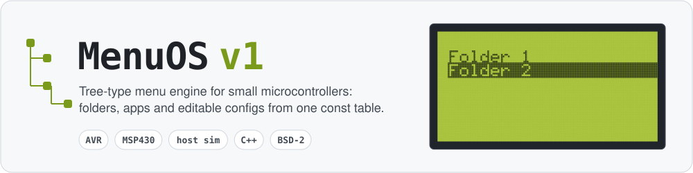
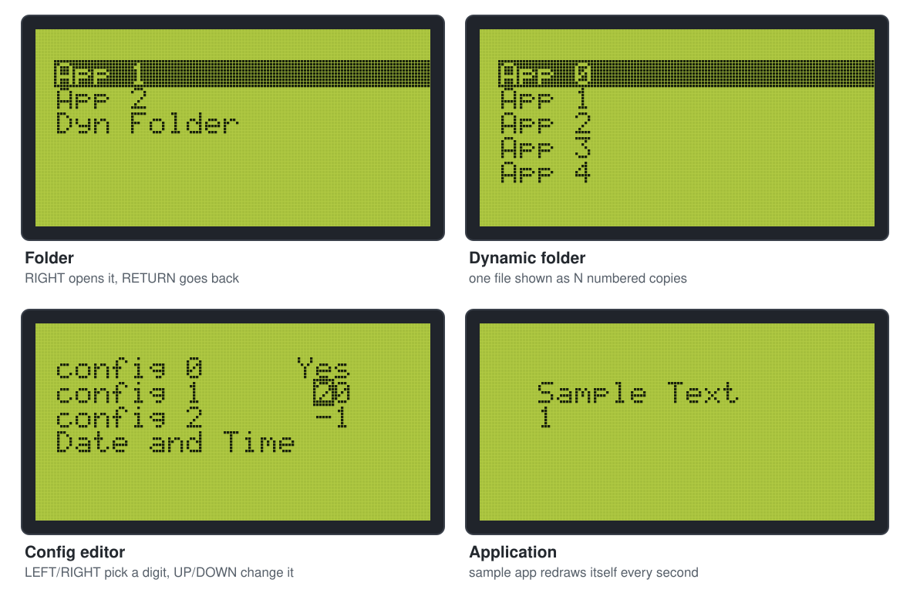
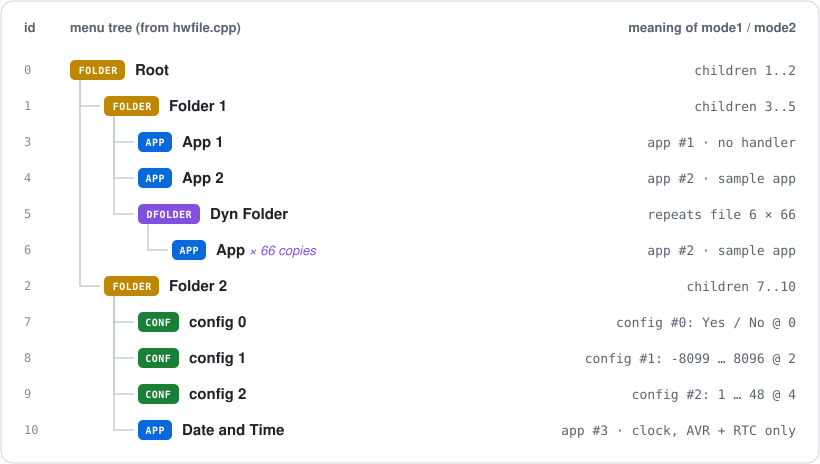

<p align="center">
  
</p>

<p align="center">
  <a href="https://github.com/radiolok/menuosv1/actions/workflows/ci.yml"></a>
  
  
  <a href="LICENSE"></a>
</p>

Almost every device with a small display needs a menu: a few folders, a couple of
applications to launch and a list of settings to edit and keep in EEPROM. Writing that
again for every project is boring, so MenuOS does it once.

You describe the whole menu as a **constant table** — folders, applications and config
values with their limits — and MenuOS takes care of navigation, paging, the value editor,
non-volatile storage and returning from applications. Five buttons, a display and a 1 ms
timer are all it needs from the hardware.

MenuOS started in August 2010 and was used in control and automation devices. This
repository is the open **v1** branch.

<p align="center">
  
</p>
<p align="center"><sub>Rendered from the real menu code by the host test suite, with the GLCD library's own 5×7 font.</sub></p>

## Features

- **Tree menu from one table** — up to 255 files, nesting depth set per board.
- **File types** — folder, *dynamic folder* (one file shown as N numbered copies, each with
  its own stored values), application, config.
- **Config editor** — numeric values with min/max and per-digit editing, or Yes/No
  switches; values live in EEPROM / flash and survive power cycles.
- **Cooperative scheduler** — 8 task slots driven by a 1 ms tick; apps get their own slots
  and button handlers.
- **Small** — no `printf`, no heap. The whole demo firmware is about 5.8 KB of flash and
  450 bytes of static RAM on MSP430G2553 (see the table below).
- **Portable** — all hardware access goes through a small port layer: AVR, MSP430 and a
  host build for tests and a terminal simulator.

## Quick start

Try it on your PC first — the simulator runs the same menu code in a terminal:

```sh
make ARCH=host sim        # arrows / WASD to move, Enter to open, q to go back
make ARCH=host test       # menu tests used by CI
```

Build firmware:

```sh
# AVR (Ubuntu/Debian: apt install gcc-avr avr-libc binutils-avr)
make ARCH=avr MCU=atmega1280

# MSP430 (TI MSP430-GCC, msp430-elf-gcc in PATH)
make ARCH=msp430 MCU=msp430g2553 MSP430_GCC_ROOT=/opt/ti/msp430-gcc
```

Results go to `build/<arch>-<mcu>/menuos.{elf,hex}`. The Atmel Studio project
(`MenuOSv1.atsln`) is still there for the original AVR board.

More in **[docs/getting-started.md](docs/getting-started.md)**.

## How it works

<p align="center">
  
</p>

The tree above is the default table in
[`menuos/hw/driver/files/hwfile.cpp`](menuos/hw/driver/files/hwfile.cpp) — the part you
edit for your device. Each entry is four bytes: `type, parent, mode1, mode2`. Children of a
folder have consecutive ids, so a folder only stores the first child and the count.
See **[docs/menu-table.md](docs/menu-table.md)**.

<p align="center">
  
</p>

The core never touches registers. It talks to the `Hw*` interface (menu table, display,
buttons), which sits on top of a board description and a port for the MCU family.

### Buttons

| Button   | In a folder                  | In the config editor  |
|----------|------------------------------|-----------------------|
| `UP`     | next item (wraps around)     | value + 10^digit      |
| `DOWN`   | previous item                | value − 10^digit      |
| `RIGHT`  | open folder / start app      | next lower digit      |
| `LEFT`   | —                            | next higher digit     |
| `RETURN` | parent folder                | save and leave        |

`UP` works as the "+" button, as on the original hardware: it moves the cursor down the
list and increases values.

## Targets

| Board header                     | MCU                         | Display                    | Config storage        | CI    |
|----------------------------------|-----------------------------|----------------------------|-----------------------|-------|
| `hw/boards/rln_electro_2012.h`   | ATmega1280 / ATmega2560     | KS0108 128×64 GLCD         | EEPROM                | build |
| `hw/boards/msp430_launchpad.h`   | MSP430G2553, MSP430F261x    | terminal over UART         | info flash, segment D | build |
| `hw/boards/host_sim.h`           | your PC                     | terminal / test frames     | RAM                   | tests |

Size of the demo firmware from CI (`-Os`, GCC; static RAM = `data` + `bss`):

| Target       | Flash (text + data) | Static RAM |
|--------------|--------------------:|-----------:|
| ATmega1280   | 15 424 B            | 697 B      |
| ATmega2560   | 15 686 B            | 697 B      |
| MSP430G2553  | 5 806 B             | 444 B      |
| MSP430F2618  | 5 518 B             | 444 B      |

The AVR build includes the GLCD library with its fonts, the DS1307 clock app and the UART
log. On the G2553 (512 B of RAM) about 70 bytes are left for the stack: enough for the menu
and the sample app, but tight for anything bigger.

The AVR board is the hardware MenuOS was written for. The MSP430 port is new: it builds in
CI but has not been run on a real chip yet. Adding a board or an MCU family is described in
**[docs/porting.md](docs/porting.md)**.

## Documentation

| | |
|---|---|
| [Getting started](docs/getting-started.md) | toolchains, building, flashing, the simulator |
| [Menu table](docs/menu-table.md) | file types, folders, dynamic folders, configs |
| [Applications](docs/apps.md) | writing an app: buttons, tasks, returning to the menu |
| [Porting](docs/porting.md) | port API, board headers, display backends |

## Video

[](https://youtube.com/watch?v=S7zko5tAmUQ)

## Project status

MenuOS v1 is an old project kept in working order: it builds, it is tested on the host,
and the bugs found while cleaning it up are fixed. New features are not planned.

## License

MenuOS is released under the [BSD 2-Clause license](LICENSE).
Bundled third-party code keeps its own license: the Arduino GLCD, Wire and Print libraries
(LGPL 2.1+) and Peter Fleury's UART library (GPL 2+), which is used by the AVR build only.
Check these before you ship closed firmware based on the AVR build.
