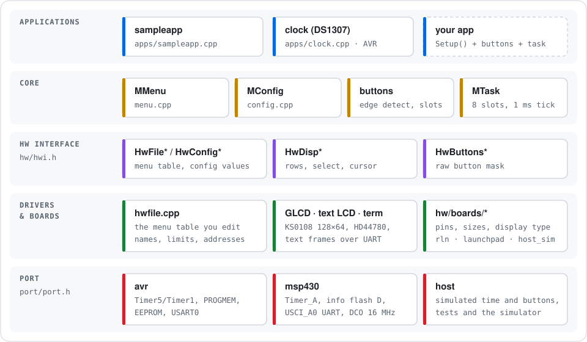

# Porting

MenuOS needs very little from the hardware, and all of it is split into two places:

- the **port** (`menuos/port/<arch>/`) — what differs between MCU families: timer,
  interrupts, program memory, non-volatile storage, console;
- the **board** (`menuos/hw/boards/<board>.h/.cpp`) — what differs between PCBs: which
  pins the buttons are on, which display is fitted, how many rows it shows.



## Port API

Declared in [`menuos/port/port.h`](../menuos/port/port.h). The architecture is picked from the
compiler (`__AVR__`, `__MSP430__`) or `-DMENUOS_HOST`.

| Function | Job |
|---|---|
| `PortInit()` | clocks, watchdog, console; first call in `main()` |
| `PortIrqEnable()` | enable interrupts globally |
| `PortIrqSave()` / `PortIrqRestore(s)` | short critical sections |
| `PortTickStart()` / `PortTickStop()` | 1 ms timer; its ISR calls `MTaskTick()` |
| `PortConsolePutc(c)` | debug log and terminal display output |
| `PortNvRead16(addr)` / `PortNvWrite16(addr, v)` | config storage, byte address, 16-bit cells |
| `PortIdle()` | called between scheduler passes (sleep here if you like) |

The port header also defines how constant tables are placed and read:

| Macro | AVR | elsewhere |
|---|---|---|
| `MENUOS_ROM` | `PROGMEM` | nothing |
| `menuos_rom_byte(p)` | `pgm_read_byte(p)` | `*(const uint8_t *)p` |
| `menuos_rom_word(p)` | `pgm_read_word(p)` | `*(const uint16_t *)p` |
| `menuos_rom_ptr(p)` | `pgm_read_word(p)` as pointer | `*(const char * const *)p` |
| `menuos_rom_strcpy(d, s)` | `strcpy_P` | `strcpy` |

### Existing ports

| Port | Tick | Config storage | Console |
|---|---|---|---|
| `avr` | Timer5 overflow on ATmega640/1280/2560 (original timing), Timer1 CTC on other ATmegas (with `TIMSK1`) | EEPROM (`eeprom_update_word`) | USART0, Fleury driver, 38400 |
| `msp430` | Timer_A CCR0, SMCLK/8 | info flash segment D, RAM mirror, rewritten only on change | USCI_A0, 9600 |
| `host` | advanced by the test harness (`HostAdvance(ms)`) | RAM | stderr (off by default) |

The MSP430 port targets the x2xx family (Basic Clock+, USCI, flash controller). F5xx/FR
parts have different clock and flash/FRAM blocks and need their own port file.

## Board header

[`menuos/hw/hwdef.h`](../menuos/hw/hwdef.h) includes one board header, chosen by
`-DMENUOS_BOARD_<NAME>` or by default for the architecture. A board header defines:

| Macro | Meaning |
|---|---|
| `BSLOTS` | number of buttons (≤ 8) |
| `BUTTONRETURN`, `BUTTONLEFT`, `BUTTONDOWN`, `BUTTONUP`, `BUTTONRIGHT` | button masks; mask = `1 << slot` |
| `GRAPH_DISPLAY` / `TEXT_DISPLAY` / `TERM_DISPLAY` | display backend |
| `DISPSTRNUMB`, `DISPSTRLENGTH` | menu rows and their width in characters |
| `MAXDEPTH` | maximum nesting depth |
| `CONFMAXADDRESS` | size of config storage, bytes |
| `MENUOS_HAS_RTC_CLOCK` | optional: build the DS1307 clock app |
| `MENUOS_NO_LOG` | optional: no log output on the console |

The board `.cpp` implements two functions:

```cpp
uint8_t HwButtonsSetup(uint8_t mode);  // configure pins, return the mask
uint8_t HwButtonsState(uint8_t mode);  // pressed buttons as a mask, 1 = pressed
```

## Display backends

All of them implement the `HwDisp*` functions from
[`hwdisp.h`](../menuos/hw/driver/disp/hwdisp.h).

| Define | Backend | Notes |
|---|---|---|
| `GRAPH_DISPLAY` | KS0108 128×64 through the Arduino GLCD library | AVR only; panel pins in `glcd/config/` |
| `TEXT_DISPLAY` | HD44780 character LCD (`tlcd/ElectroLCD`) | AVR only |
| `TERM_DISPLAY` | text frame buffer printed to the console | any MCU; also used by the tests |

The terminal backend draws into a buffer and prints the whole frame from `HwDispUpdate()`,
which the scheduler calls once per main-loop pass, only when something changed. With
`MENUOS_TERM_ANSI` it clears the terminal first.

## Adding an MCU family

1. Create `menuos/port/<arch>/port_<arch>.h` with the ROM macros and
   `port_<arch>.cpp` with the functions above.
2. Add a branch for it in `port.h`.
3. Add a board header + `.cpp`, and its default in `hwdef.h`.
4. Add `ARCH=<arch>` to the `Makefile` (toolchain prefix, `-mmcu`, source list).
5. Add a CI job.

## Checking without hardware

`make ARCH=host test` exercises the menu, config editor, dynamic folders and the task
manager with the host port. Hardware-specific code (timers, flash, pins) is only compiled
by the AVR and MSP430 CI jobs, so a new port should at least build there before it is
tried on a chip.
